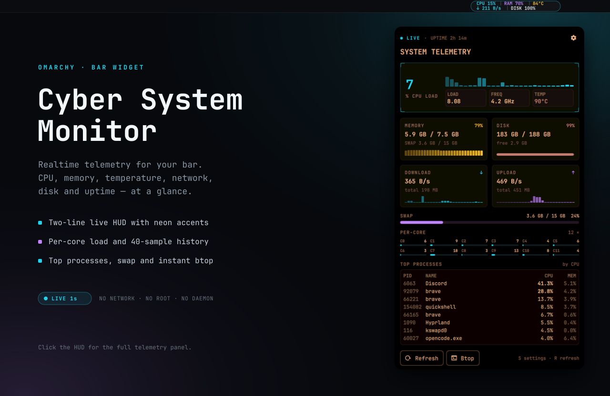

# Sys Analytics

A realtime system monitor for the [Omarchy](https://omarchy.org/) shell: a
compact single-row HUD in the bar and a full telemetry panel on click.



## What it shows

**Bar HUD** — one row, every metric optional

`CPU %` · `RAM %` · `CPU temp` · `download speed` · `root disk %` · `uptime`

Each cell can be toggled from the panel's settings view. Uptime is off by
default, so the HUD stays narrow on a normal setup.

**Panel** (click the HUD)

- CPU hero with a 40-sample history graph, load average, current frequency, and package temperature.
- Memory, disk, download, and upload cards with live graphs and totals.
- Swap usage, shown only when the machine has swap.
- Per-core load strip for every CPU thread.
- Top processes by CPU, with CPU and memory percentages.
- Settings view for choosing which metrics appear in the bar, the neon accent
  toggle, and the sample interval.

## Interactions

| Action | Result |
| --- | --- |
| Click | Open or close the telemetry panel |
| Middle click | Sample again immediately |
| Right click | Launch or focus `btop` |
| `S` | Toggle the panel's settings view |
| `R` | Refresh the current sample |
| `B` | Open btop from the panel |
| `Esc` | Close the panel |

## Requirements

- Omarchy with the Quattro shell (`bar-widget` plugin support).
- `bash`, `coreutils`, `procps` (`ps`), `awk`, and `df` — all present on a
  normal Arch/Omarchy install.
- `btop` is optional; only the right-click action uses it.

The sampler reads `/proc`, `/sys/class/hwmon`, `/sys/class/thermal`, and `df`.
It does not use the network, does not require root, and starts no background
daemon.

## Install

From the plugin marketplace page, or directly:

```bash
omarchy plugin add https://github.com/Adicodes270/sys-analytics.git --enable
```

For local development, link the checkout into the user plugin directory and
rescan:

```bash
ln -s "$PWD" ~/.config/omarchy/plugins/aditya27003.sys-analytics
omarchy-shell shell rescanPlugins
```

Then enable it on the right side of the bar:

```bash
omarchy plugin enable aditya27003.sys-analytics --section right
```

## Settings

Open the panel and press `S`, or click the gear. Choices are stored in the
widget's entry in `~/.config/omarchy/shell.json`.

| Setting | Default | Effect |
| --- | --- | --- |
| CPU usage | on | CPU percentage in the bar |
| Memory usage | on | RAM percentage in the bar |
| CPU temperature | on | Package temperature in the bar |
| Network speed | on | Download rate in the bar |
| Disk usage | on | Root filesystem percentage in the bar |
| Uptime | off | Uptime in the bar |
| Neon accents | on | Cyan/violet HUD accents; off follows the theme accent |
| Sample interval | 1 s | 0.5 s, 1 s, or 2 s |

The panel always shows every metric, even when a bar cell is hidden.

## How it works

- `BarWidget.qml` is the manifest entry point. It owns the bar HUD and the
  single sampler.
- `scripts/sample.sh` collects every metric in one process per tick and prints
  labelled sections. It also records the exact moment `/proc/net/dev` was read
  and the lowest-metric default-route interface.
- `Model.js` parses `/proc/stat`, `/proc/meminfo`, `/proc/net/dev`, `df`,
  hwmon/thermal sensors, uptime, load average, and `ps`, and keeps the
  formatting helpers.
- `Panel.qml` is loaded by `BarWidget.qml` and reads the same live properties,
  so the bar and panel can never disagree.
- `components/` holds the small drawing pieces: `LevelBar`, `Sparkline`,
  `MetricCard`, and `CornerTicks`.

CPU and network rates are measured as deltas between samples. Network speed is
measured on the default-route interface rather than by summing every interface:
bridges and virtual devices (Docker, veth, VPNs) mirror packets already counted
on the physical link, so adding them together inflates the reading. The rate
uses the sampler's own counter timestamp, which removes process-startup jitter
from the interval. Switching interfaces resets the baseline instead of
producing a spike. The first tick after the shell starts has no previous
reading, so CPU shows `--` and network speeds start at zero.

## Troubleshooting

- **The widget is not in the bar:** `omarchy plugin enable aditya27003.sys-analytics --section right`
- **No temperature:** some machines expose no CPU package sensor. The widget
  falls back to `x86_pkg_temp`/`cpu-thermal`, then to the first thermal zone,
  and shows `n/a` when nothing is readable.
- **QML errors:** `omarchy restart shell`, then `qs log -p /usr/share/omarchy/shell --tail 100`.
- **Blank graphs right after login:** wait one or two samples.
- **Network speed stays at zero:** confirm the machine has a default route
  (`cat /proc/net/route`); without one the widget falls back to the physical
  interfaces.

## Development

```bash
omarchy plugin validate .
qmllint -I "$OMARCHY_PATH/shell" BarWidget.qml Panel.qml components/*.qml
node -e "require('./Model.js')"
```

Changes to the QML hot-reload in the running shell. Use
`omarchy-shell shell summon aditya27003.sys-analytics '{}'` to open the panel
without the mouse and `omarchy-shell shell hide aditya27003.sys-analytics` to
close it.

## License

MIT — see [LICENSE](LICENSE).

Author: **Aditya Kumar** ([@Adicodes270](https://github.com/Adicodes270))
